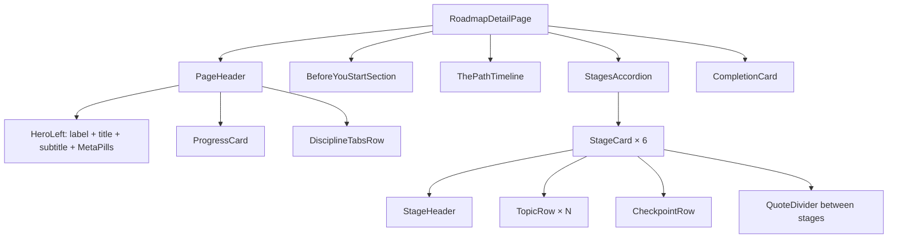
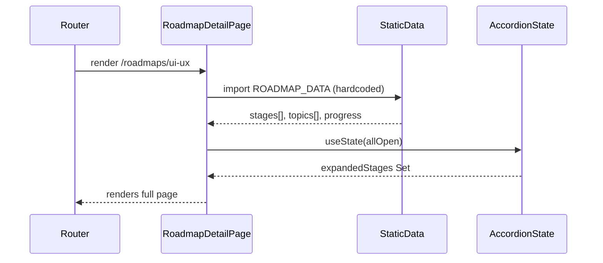
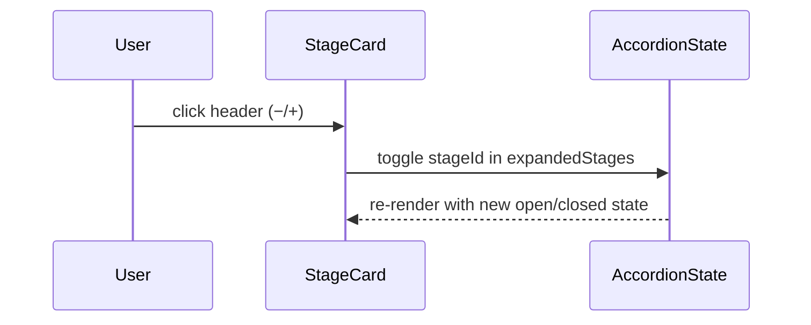

# Design Document: Roadmap Detail Page

## Overview

A full redesign of `RoadmapDetailPage` to match the Figma design (node 25:23, "Roadmap / UI-UX (full)"). The page replaces the current minimal API-driven layout with a rich, static-data driven experience that shows the complete UI/UX Designer roadmap with six sections: a hero header, a "Before you start" triptych, a horizontal timeline, an accordion of stages with topic rows, a completion card, and the shared Footer. All data is hardcoded; progress state is simulated to show all visual variants (done, in-progress, locked, not-started).

The page sits at `/roadmaps/ui-ux` (matched via the existing `:id` route), is wrapped in `RequireAuth`, uses the Navbar/Footer from `AppLayout`, and is built entirely in React + TypeScript with Tailwind CSS v4 utility classes — no new runtime dependencies required.

---

## Architecture



---

## Sequence Diagrams

### Page Load Flow



### Accordion Toggle Flow



---

## Components and Interfaces

### Component: `RoadmapDetailPage`

**Purpose**: Root page component; owns accordion state and renders all sections.

**Interface**:
```typescript
// no props — reads `id` from useParams, ignores it (static data)
export function RoadmapDetailPage(): JSX.Element
```

**Responsibilities**:
- Import static `ROADMAP_DATA` constant
- Manage `expandedStages: Set<number>` state (all open by default)
- Provide `toggleStage(id: number) => void` handler
- Render all page sections in order

---

### Component: `PageHeader`

**Purpose**: Full-width hero header with title, meta pills, progress card, and discipline tabs.

**Interface**:
```typescript
interface PageHeaderProps {
  roadmap: RoadmapData
  progress: ProgressState
}
```

**Responsibilities**:
- Render left block: roadmap label, large title (96px), subtitle, 4 meta pills
- Render right block: `ProgressCard`
- Render bottom: `DisciplineTabsRow`

---

### Component: `ProgressCard`

**Purpose**: Floating card showing user progress percentage, bar, and CTA.

**Interface**:
```typescript
interface ProgressCardProps {
  completedTopics: number
  totalTopics: number
  continueTopicTitle: string
}
```

**Responsibilities**:
- Compute percentage from `completedTopics / totalTopics`
- Render percentage as large number (72px)
- Render progress bar with orange fill
- Render "Continue: [title] →" CTA button
- Render "Progress saves when you're signed in" muted note

---

### Component: `BeforeYouStartSection`

**Purpose**: Section with 3 equal cards covering audience, prerequisites, and outcomes.

**Interface**:
```typescript
interface BeforeYouStartCard {
  colorLabel: string   // e.g. "WHO THIS IS FOR"
  title: string
  bullets: string[]
}

interface BeforeYouStartSectionProps {
  cards: BeforeYouStartCard[]
}
```

**Responsibilities**:
- Render section label "(Before you start)"
- Render 3 cards in a row; each card has colored heading, title, and bullet list

---

### Component: `ThePathTimeline`

**Purpose**: Horizontal strip showing 6 stage segments with color-coded progress indicators.

**Interface**:
```typescript
interface TimelineSegmentData {
  stageNumber: number
  weekLabel: string    // e.g. "Week 1-2"
  stageName: string
  topicsCount: number
  status: 'done' | 'in-progress' | 'upcoming'
}

interface ThePathTimelineProps {
  segments: TimelineSegmentData[]
  onExpandAll: () => void
  onCollapseAll: () => void
}
```

**Responsibilities**:
- Render header row with label, pace text, expand/collapse pills
- Render 6 segments; done/in-progress = orange top bar, upcoming = dim bar
- Each segment shows stage number, week range, name, and topic count

---

### Component: `StageCard`

**Purpose**: Expandable accordion card for a single stage.

**Interface**:
```typescript
interface StageCardProps {
  stage: StageData
  isOpen: boolean
  onToggle: () => void
}
```

**Responsibilities**:
- Render stage header row (number, title block, progress fraction, progress bar, toggle)
- Render optional prerequisite pill or "Done" pill
- When `isOpen`: render topic rows and checkpoint rows
- Animate open/close with CSS max-height transition

---

### Component: `TopicRow`

**Purpose**: Single row for a learning topic inside a stage.

**Interface**:
```typescript
interface TopicRowProps {
  topic: TopicData
}
```

**Responsibilities**:
- Render check circle with correct visual state (done/in-progress/not-started/locked)
- Render title with muted color if done or locked
- Render optional "Needs:" pill
- Render difficulty slot (● / ●● / ●●●)
- Render time slot
- Render action slot ("Review" | "Start →" pill | empty)

---

### Component: `CheckpointRow`

**Purpose**: Special row inside a stage marking a hands-on checkpoint task.

**Interface**:
```typescript
interface CheckpointRowProps {
  checkpoint: CheckpointData
}
```

**Responsibilities**:
- Render warm dark background (`rgba(74,27,12,0.35)`)
- Render "CHECKPOINT" label in orange
- Render task description and time estimate
- Render status pill ("Done" or "See brief →")

---

### Component: `CompletionCard`

**Purpose**: Full-width card at the bottom of the page with finish-line messaging and CTAs.

**Interface**:
```typescript
interface CompletionCardProps {
  completedTopics: number
  totalTopics: number
}
```

**Responsibilities**:
- Render "(The finish line)" label
- Render "Now go ship it." heading
- Render subtitle text
- Render 3 action buttons: primary, secondary, disabled

---

## Data Models

### `RoadmapData`

```typescript
interface RoadmapData {
  id: string
  number: string           // e.g. "01"
  title: string            // e.g. "UI/UX\nDesigner"
  label: string            // e.g. "Roadmap 01"
  subtitle: string
  metaPills: string[]      // 4 pills: "6 Stages", "38 Topics", "~13 hrs", "Beginner friendly"
  disciplines: DisciplineTab[]
  stages: StageData[]
  beforeYouStart: BeforeYouStartCard[]
  timelinePace: string     // "6 weeks at 30 minutes a day"
}

interface DisciplineTab {
  label: string
  active: boolean
}
```

### `StageData`

```typescript
interface StageData {
  id: number               // 1–6
  number: string           // "STAGE 01"
  name: string
  subtitle: string
  byTheEnd: string
  topics: TopicData[]
  checkpoints: CheckpointData[]
  prerequisiteStage?: number
  status: 'done' | 'in-progress' | 'upcoming'
  completedTopics: number
  totalTopics: number
}
```

### `TopicData`

```typescript
type TopicStatus = 'done' | 'in-progress' | 'not-started' | 'locked'
type Difficulty = 'beginner' | 'intermediate' | 'advanced'

interface TopicData {
  id: number
  title: string
  status: TopicStatus
  difficulty: Difficulty
  timeMinutes: number
  needsStage?: number      // prerequisite stage number if locked
  action?: 'review' | 'start'
}
```

### `CheckpointData`

```typescript
interface CheckpointData {
  id: number
  task: string
  timeEstimate: string     // e.g. "~2 hrs"
  status: 'done' | 'pending'
}
```

### `ProgressState`

```typescript
interface ProgressState {
  completedTopics: number
  totalTopics: number
  continueTopicTitle: string
}
```

---

## Algorithmic Pseudocode

### Main Page Render Algorithm

```pascal
ALGORITHM renderRoadmapDetailPage()
INPUT: none (uses static ROADMAP_DATA constant)
OUTPUT: JSX tree

BEGIN
  expandedStages ← useState(Set containing ids of ALL stages)
  
  FUNCTION toggleStage(stageId)
    IF stageId IN expandedStages THEN
      expandedStages.delete(stageId)
    ELSE
      expandedStages.add(stageId)
    END IF
  END FUNCTION
  
  progress ← computeProgress(ROADMAP_DATA.stages)
  
  RETURN
    <div bg-[#080808]>
      <PageHeader roadmap=ROADMAP_DATA progress=progress />
      <BeforeYouStartSection cards=ROADMAP_DATA.beforeYouStart />
      <ThePathTimeline
        segments=ROADMAP_DATA.stages
        onExpandAll=() => expandedStages ← ALL_STAGE_IDS
        onCollapseAll=() => expandedStages ← empty Set
      />
      FOR stage IN ROADMAP_DATA.stages DO
        <StageCard
          stage=stage
          isOpen=(stage.id IN expandedStages)
          onToggle=() => toggleStage(stage.id)
        />
        IF stage.id < 6 THEN
          <QuoteDivider quote=STAGE_QUOTES[stage.id] />
        END IF
      END FOR
      <CompletionCard completedTopics=progress.completedTopics totalTopics=progress.totalTopics />
    </div>
END
```

**Preconditions**:
- `ROADMAP_DATA` is a valid constant with 6 stages
- Each stage has at least 1 topic

**Postconditions**:
- All 6 stage cards are rendered
- expandedStages reflects current open/closed state
- Progress values are derived from topic statuses

**Loop Invariants**:
- For each iteration, stage.id is in range [1..6]
- Rendered stage count equals `ROADMAP_DATA.stages.length`

---

### Progress Computation Algorithm

```pascal
ALGORITHM computeProgress(stages)
INPUT: stages array of StageData
OUTPUT: ProgressState

BEGIN
  completedTopics ← 0
  totalTopics ← 0
  continueTitle ← ""
  
  FOR stage IN stages DO
    FOR topic IN stage.topics DO
      totalTopics ← totalTopics + 1
      IF topic.status = 'done' THEN
        completedTopics ← completedTopics + 1
      END IF
      IF continueTitle = "" AND topic.status = 'in-progress' THEN
        continueTitle ← topic.title
      END IF
    END FOR
  END FOR
  
  RETURN { completedTopics, totalTopics, continueTitle }
END
```

**Preconditions**: stages is a non-empty array with valid topic statuses

**Postconditions**:
- `completedTopics ≤ totalTopics`
- `continueTitle` is the title of the first in-progress topic, or empty if none

**Loop Invariants**: `completedTopics ≤ totalTopics` holds throughout both loops

---

### Topic Check Circle Rendering Algorithm

```pascal
ALGORITHM renderCheckCircle(status)
INPUT: status of type TopicStatus
OUTPUT: JSX element (26×26 circle)

BEGIN
  IF status = 'done' THEN
    RETURN circle(bg=#ff6a00, content=white-checkmark)
  ELSE IF status = 'in-progress' THEN
    RETURN circle(border=1px #302923, inner-dot=orange)
  ELSE IF status = 'not-started' THEN
    RETURN circle(border=1px #302923, empty)
  ELSE  // locked
    RETURN circle(border=1px #302923, opacity=0.4, empty)
  END IF
END
```

---

### Difficulty Dots Rendering Algorithm

```pascal
ALGORITHM renderDifficulty(difficulty)
INPUT: difficulty of type Difficulty
OUTPUT: string with colored dots

BEGIN
  IF difficulty = 'beginner' THEN
    RETURN "● Beginner"  // 1 filled dot
  ELSE IF difficulty = 'intermediate' THEN
    RETURN "●● Intermediate"  // 2 filled dots
  ELSE  // advanced
    RETURN "●●● Advanced"  // 3 filled dots
  END IF
END
```

---

## Key Functions with Formal Specifications

### `computeProgress(stages: StageData[]): ProgressState`

**Preconditions**:
- `stages` is non-null and non-empty
- Each `topic.status` is one of `'done' | 'in-progress' | 'not-started' | 'locked'`

**Postconditions**:
- `result.completedTopics` equals the count of all topics with `status === 'done'` across all stages
- `result.totalTopics` equals the total count of all topics across all stages
- `result.completedTopics ≤ result.totalTopics`
- `result.continueTopicTitle` is the title of the first topic (by stage order, then topic order) with `status === 'in-progress'`, or `""` if none exists

---

### `getTopicActionLabel(topic: TopicData): 'review' | 'start' | null`

**Preconditions**: `topic` is a valid `TopicData` object

**Postconditions**:
- Returns `'review'` if `topic.status === 'done'`
- Returns `'start'` if `topic.status === 'not-started'` or `'in-progress'`
- Returns `null` if `topic.status === 'locked'`

---

### `getDifficultyLabel(difficulty: Difficulty): string`

**Preconditions**: `difficulty` is `'beginner' | 'intermediate' | 'advanced'`

**Postconditions**:
- Returns a string of 1, 2, or 3 `●` dots followed by a capitalized label
- `getDifficultyLabel('beginner')` === `'● Beginner'`
- `getDifficultyLabel('intermediate')` === `'●● Intermediate'`
- `getDifficultyLabel('advanced')` === `'●●● Advanced'`

---

### `formatTime(minutes: number): string`

**Preconditions**: `minutes > 0`

**Postconditions**:
- Returns `'${minutes} min'` string
- Output is deterministic for equal inputs

---

## Example Usage

```typescript
// Static data constant (abbreviated)
const ROADMAP_DATA: RoadmapData = {
  id: 'ui-ux',
  number: '01',
  title: 'UI/UX\nDesigner',
  label: 'Roadmap 01',
  subtitle: 'The complete path from zero to a portfolio that gets you hired.',
  metaPills: ['6 Stages', '38 Topics', '~13 hrs', 'Beginner friendly'],
  disciplines: [
    { label: 'UI/UX Design', active: true },
    { label: 'Visual Design', active: false },
    { label: 'Research', active: false },
    { label: 'Prototyping', active: false },
  ],
  timelinePace: '6 weeks at 30 minutes a day',
  beforeYouStart: [
    {
      colorLabel: 'WHO THIS IS FOR',
      title: 'Total beginners & career switchers',
      bullets: [
        'No design experience needed',
        'Anyone curious about UX',
        'Career switchers entering tech',
      ],
    },
    // ... 2 more cards
  ],
  stages: [
    {
      id: 1,
      number: 'STAGE 01',
      name: 'Foundations',
      subtitle: 'Design thinking and visual basics',
      byTheEnd: 'You can explain what UX is and sketch a basic wireframe',
      status: 'done',
      completedTopics: 6,
      totalTopics: 6,
      topics: [
        {
          id: 1,
          title: 'What is UX Design?',
          status: 'done',
          difficulty: 'beginner',
          timeMinutes: 10,
          action: 'review',
        },
        // ...
      ],
      checkpoints: [
        {
          id: 1,
          task: 'Sketch 3 wireframes for a mobile app onboarding flow',
          timeEstimate: '~2 hrs',
          status: 'done',
        },
      ],
    },
    // ... 5 more stages
  ],
}

// Rendering the page
function RoadmapDetailPage() {
  const [expandedStages, setExpandedStages] = useState(
    () => new Set(ROADMAP_DATA.stages.map((s) => s.id))
  )
  const progress = computeProgress(ROADMAP_DATA.stages)
  // ...renders PageHeader, sections, StageCards
}

// Using computeProgress
const progress = computeProgress(ROADMAP_DATA.stages)
// => { completedTopics: 9, totalTopics: 38, continueTopicTitle: "Typography basics" }
```

---

## Correctness Properties

*A property is a characteristic or behavior that should hold true across all valid executions of a system — essentially, a formal statement about what the system should do. Properties serve as the bridge between human-readable specifications and machine-verifiable correctness guarantees.*

### Property 1: Progress computation accuracy

*For any* array of stages containing any mix of topic statuses, `computeProgress` must return `completedTopics` equal to the exact count of topics with `status === 'done'`, and `totalTopics` equal to the total count of all topics across all stages.

**Validates: Requirements 3.1, 3.2**

### Property 2: Progress fraction invariant

*For any* valid stages array, `computeProgress(stages).completedTopics` is always less than or equal to `computeProgress(stages).totalTopics`.

**Validates: Requirements 3.1, 3.3**

### Property 3: Difficulty label determinism

*For any* valid `Difficulty` value, `getDifficultyLabel` always returns the same string for the same input, and that string contains exactly the correct number of `●` characters — 1 for `'beginner'`, 2 for `'intermediate'`, and 3 for `'advanced'`.

**Validates: Requirements 5.5**

### Property 4: Action label derivation

*For any* `TopicData` object, `getTopicActionLabel` returns `'review'` if and only if `status === 'done'`, `null` if and only if `status === 'locked'`, and `'start'` for `'not-started'` or `'in-progress'` — covering all four possible `TopicStatus` values.

**Validates: Requirements 5.7, 5.8, 5.9**

### Property 5: Time format determinism

*For any* positive integer `minutes`, `formatTime(minutes)` returns a non-empty string that contains that integer value and the substring `"min"`.

**Validates: Requirements 5.6**

### Property 6: Accordion toggle round-trip

*For any* stage ID that is present in the expanded set, toggling it once removes it; toggling it a second time adds it back — leaving the set in its original state (round-trip / idempotence of the toggle operation).

**Validates: Requirements 4.2**

---

## Error Handling

### Scenario 1: Unknown roadmap ID in URL

**Condition**: User navigates to `/roadmaps/unknown-id`
**Response**: Page renders with `ROADMAP_DATA` (static data is always the UI/UX roadmap); a future enhancement can check the `id` param and show a 404 state
**Recovery**: Not applicable for static data phase

### Scenario 2: Missing `continueTopicTitle`

**Condition**: All topics are either `'done'` or `'locked'` — no `'in-progress'` topic exists
**Response**: `computeProgress` returns `continueTopicTitle: ""`, `ProgressCard` shows a fallback label "Start where you left off"
**Recovery**: Graceful empty-string check in the component

### Scenario 3: Stage with zero topics

**Condition**: A `StageData.topics` array is empty (malformed static data)
**Response**: `StageCard` renders the header but the body is empty; `completedTopics / totalTopics` division is guarded by `totalTopics === 0` check (returns 0%)
**Recovery**: Defensive guard in progress computation

---

## Testing Strategy

### Unit Testing Approach

Test the pure utility functions in isolation using Vitest:
- `computeProgress` with various mixes of topic statuses
- `getDifficultyLabel` for all three difficulty values
- `getTopicActionLabel` for all four topic statuses
- `formatTime` for boundary values (1 min, 60 min, 999 min)

### Property-Based Testing Approach

**Property Test Library**: `fast-check` (add as a dev dependency)

Property tests target the pure helper functions which have well-defined universal invariants:
- `computeProgress` invariant: completedTopics ≤ totalTopics
- `getDifficultyLabel` determinism across all valid inputs
- `getTopicActionLabel` correctness across all valid status values
- `formatTime` output always contains the input number

### Integration Testing Approach

Use `@testing-library/react` to render `RoadmapDetailPage` with the static data and assert:
- All 6 stage cards are present in the DOM
- Progress percentage matches expected computed value
- Toggling a stage card's header collapses/expands its body
- "Expand all" / "Collapse all" pills affect all stages

---

## Performance Considerations

- Static data: no API calls, no loading states, instant render
- 6 stage cards × ~8 topic rows = ~48 rows; all rendered in the DOM (no virtualization needed at this scale)
- CSS `max-height` transitions for accordion open/close; `will-change: max-height` can be added if jank is observed
- Images: none required for this page (all UI is CSS/SVG)

---

## Security Considerations

- No user input is accepted on this page; no injection surface
- The `RequireAuth` wrapper (already in the router) ensures the page is only accessible to authenticated users
- Static data contains no secrets or PII

---

## Dependencies

**Existing (no new installs required)**:
- `react` + `react-dom` v19
- `typescript` ~6
- `tailwindcss` v4 (Tailwind CSS v4 + `@tailwindcss/vite`)
- `react-router-dom` v7 (for `useParams`)
- `lucide-react` (optional, for icons if needed)

**New (dev only, for property tests)**:
- `fast-check` — property-based testing library (to be added as a dev dependency)
